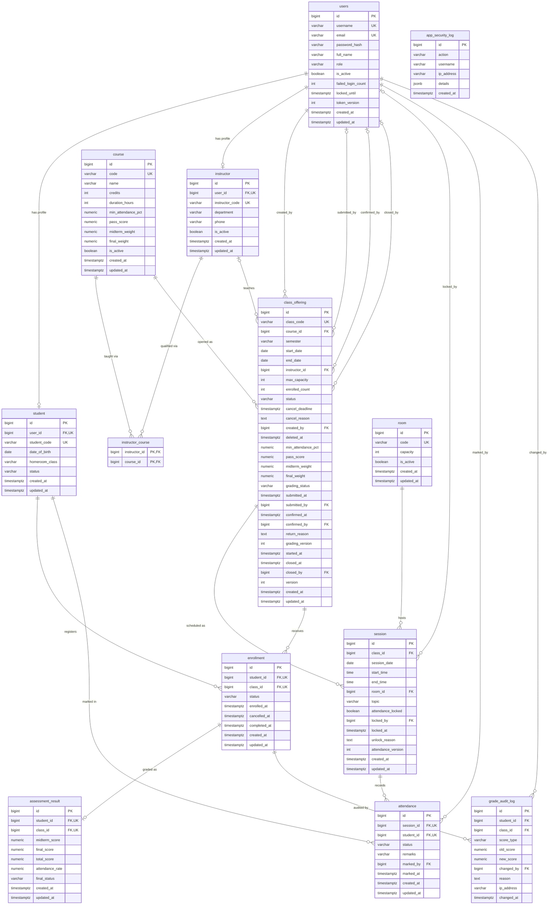

# P02 Training Management: Database Design

**Status: APPROVED AND IMPLEMENTED.** Flyway migration V1 is applied to `p02_training` and `p02_training_test`, and all 13 JPA entities are validated against it. See [section 16](#16-implementation-status) and [section 17](#17-jpa-entities).

**Requirements source:** `docs/P02-Training-Management-Specification.docx` (all parts, Part 0 to Part 5, plus the class-status diagram). Spec references use its own numbering, such as `2.1`, `D13` or `TR14`. **D01-D22 are treated as confirmed business requirements** ([section 9](#9-confirmed-decisions-d01-d22)).

**Source of truth:** the applied `V1__create_initial_schema.sql` and the live `p02_training` schema define the actual structure. `proposed-schema.sql` holds the approved statements, identical to V1 apart from comments. V1 is immutable, so every schema change needs a new migration, such as V2.

**Related files:** [relationships](database-relationships.md), [open questions](database-ambiguities.md), [decision package](database-decision-package.md), [review checklist](database-review-checklist.md), [proposed SQL](proposed-schema.sql).

## 1. How to read this design

No original schema exists, so every table is new. Each column and constraint shows whether it comes from the spec, was inferred, comes from a decision you approved, is a technical default, or is still open.

### Column basis: `existence/definition`

| Letter | Existence: should this column exist? | Definition: type, nullability, default |
|---|---|---|
| **S** (Stated) | The spec names this data item | The spec states the type |
| **I** (Inferred) | Not named, but the spec's flows require it | Derived from the spec's validation rules or flows |
| **A** (Approved) | Added by a decision you approved | Set by a decision you approved |
| **T** (Technical default) | - | Default applied; no business behaviour implied |
| **C** (Confirm) | Still open | Still open: a draft, not a decision |

For example, `S/C` means the spec clearly requires the column, but its definition is a draft waiting on an open question. Where a column comes from an API field or Vietnamese description, its physical name is a design choice ([A-03](database-ambiguities.md#a-03-physical-names)).

### Constraint basis

- **[S]** the spec states the rule or constraint.
- **[I]** the spec states the rule in a flow; enforcing it in the database is inferred.
- **[A]** set by a decision you approved.
- **[T]** technical default applied.
- **[C]** draft only; business decision still open.

### Totals

| Table | Columns | S/S | S/I | S/A | S/T | S/C | I/I | I/A | A/A |
|---|---|---|---|---|---|---|---|---|---|
| `users` | 12 | 2 | 4 | 2 | 2 | 0 | 0 | 0 | 2 |
| `student` | 8 | 0 | 1 | 2 | 2 | 0 | 1 | 0 | 2 |
| `instructor` | 8 | 0 | 0 | 2 | 3 | 0 | 1 | 0 | 2 |
| `course` | 12 | 2 | 2 | 2 | 2 | 2 | 0 | 0 | 2 |
| `instructor_course` | 2 | 0 | 2 | 0 | 0 | 0 | 0 | 0 | 0 |
| `room` | 6 | 0 | 1 | 2 | 1 | 0 | 0 | 0 | 2 |
| `class_offering` | 31 | 5 | 11 | 3 | 8 | 1 | 0 | 0 | 3 |
| `session` | 14 | 3 | 2 | 3 | 2 | 1 | 1 | 0 | 2 |
| `enrollment` | 9 | 2 | 3 | 2 | 0 | 0 | 0 | 0 | 2 |
| `attendance` | 9 | 1 | 4 | 0 | 1 | 0 | 0 | 1 | 2 |
| `assessment_result` | 10 | 0 | 6 | 0 | 0 | 0 | 1 | 1 | 2 |
| `grade_audit_log` | 10 | 1 | 4 | 0 | 4 | 0 | 0 | 1 | 0 |
| `app_security_log` | 6 | 1 | 0 | 2 | 1 | 0 | 0 | 1 | 1 |
| **Total** | **137** | **17** | **40** | **20** | **26** | **4** | **4** | **4** | **22** |

So the spec names 107 of the 137 columns but states the type of only 17. Another 22 were added by your decisions, and 4 follow the literal spec while a question stays unresolved.

## 2. Features and processes that store data

TR08 and TR11 are internal rules, and TR09, TR13, TR17 and TR18 only read. All of them still shape the indexes and constraints.

| Feature | Process | Writes | Reads |
|---|---|---|---|
| TR01 | Login, lockout, logout, password, account management | `users`, `student`, `instructor`, `app_security_log` | `users` |
| TR02 | Course catalog | `course`, `app_security_log` | `class_offering` |
| TR03 | Instructor profile, teachable courses | `instructor`, `instructor_course`, `app_security_log` | `course`, `class_offering` |
| TR04 | Student profile and status | `student`, `app_security_log` | `users` |
| TR05 | Class creation and lifecycle | `class_offering`, `enrollment`, `session`, `app_security_log` | `course`, `instructor`, `instructor_course`, `room`, `session` |
| TR06 | Sessions and rooms | `session`, `room`, `app_security_log` | `class_offering`, `instructor` |
| TR07 | Assign instructor | `class_offering`, `app_security_log` | `instructor`, `instructor_course`, `users`, `session` |
| TR08 | Conflict checks | None | `session`, `class_offering`, `enrollment` |
| TR09 | Browse classes | None | `class_offering`, `course`, `instructor`, `users` |
| TR10 | Enroll | `enrollment`, `class_offering`, `app_security_log` | `student`, `session` |
| TR11 | Seat count rule | `class_offering.enrolled_count` | `enrollment` |
| TR12 | Cancel enrollment | `enrollment`, `class_offering`, `app_security_log` | `student` |
| TR13 | Class roster | None | `enrollment`, `student`, `users` |
| TR14 | Attendance, lock, unlock | `attendance`, `session`, `app_security_log` | `enrollment`, `class_offering` |
| TR15 | Scores and submission | `assessment_result`, `grade_audit_log`, `class_offering`, `app_security_log` | `enrollment` |
| TR16 | Return, confirm, complete | `class_offering`, `assessment_result`, `enrollment`, `app_security_log` | `session`, `attendance` |
| TR17 | Personal schedule | None | `session`, `room`, `class_offering`, `course`, `enrollment` |
| TR18 | Dashboard, alerts, grade audit | None | `class_offering`, `enrollment`, `assessment_result`, `app_security_log`, `grade_audit_log` |

## 3. How the entities were identified

### Proposed: 13 tables

I identified these by reading the spec's flows, not by starting from a number. Each name appears directly in the spec as something stored.

| # | Table | Spec name | Why it needs its own table |
|---|---|---|---|
| 1 | `users` | User | Login, role, lockout and revocation for all four roles |
| 2 | `student` | Student | Profile data and a status separate from the account (TR04) |
| 3 | `instructor` | Instructor | Profile data and a separate teaching status (TR03) |
| 4 | `course` | Course | Catalog with its own lifecycle (TR02) |
| 5 | `instructor_course` | InstructorCourse | Many-to-many: who can teach what (TR03) |
| 6 | `room` | Room | Managed resource, checked for conflicts (TR06) |
| 7 | `class_offering` | ClassOffering | Lifecycle, seats, grading state (TR05, TR16) |
| 8 | `session` | Session | Schedule and attendance lock per session (TR06, TR14) |
| 9 | `enrollment` | Enrollment | Student-class registration with its own status (TR10) |
| 10 | `attendance` | Attendance | Per student, per session (TR14) |
| 11 | `assessment_result` | AssessmentResult | Scores and outcome per student in a class (TR15) |
| 12 | `grade_audit_log` | GradeAuditLog | Separate log for score changes (0.6, TR15) |
| 13 | `app_security_log` | AppSecurityLog | Security and action log (0.6) |

**About the number 13:** Part 2 does say "Vẫn giữ 13 bảng, chỉ thêm field vào 5 bảng", but it doesn't list them. The count derived here matches it. That sentence also implies an earlier design that isn't available, so everything is treated as new here. D01-D22 add no tables, all 13 remain necessary after review, and they are the V1 scope you chose ([A-02](database-ambiguities.md#a-02-table-list)).

### Considered and not proposed as tables

| Candidate | Spec evidence | Decision |
|---|---|---|
| Semester | `semester` is only "không rỗng" and a filter | Column |
| Department ("khoa") | Single value on the instructor (TR03) | Column |
| Role | Fixed values in D04; stored on the user | `CHECK` values |
| Refresh tokens, JWT blacklist | Revocation uses `token_version` only (0.2) | Not needed |
| CSRF tokens | Cookie double-submit (0.2) | Not stored |
| Login rate-limit counters | 30 requests per minute per IP (D03); storage not stated | Not in the database, [A-26](database-ambiguities.md#a-26-rate-limit-storage) |
| Enrollment history | D06 reuses the same row | Not needed; `app_security_log` records actions |
| Unlock and return history | Only `unlock_reason` and `return_reason`, plus logs | Not needed |
| Dashboard data | Computed by query (TR18) | Not stored |

## 4. ERD

Showing the keys and all columns. Attribute types are simplified for the diagram, so see section 5 for exact types. `app_security_log` is deliberately unconnected.

## 5. Table definitions

`-` means none. Each row's Basis uses the tags from section 1. Foreign keys block deleting a referenced row unless noted.

### 5.1 `users`

**Purpose:** accounts for all four roles, login lockout and session revocation.

| Column | Type | Null | Default | Key | Check | Basis | Source and notes |
|---|---|---|---|---|---|---|---|
| `id` | `BIGINT` identity | NOT NULL | Identity | PK | - | S/A | JWT `sub`; A-04 |
| `username` | `VARCHAR(50)` | NOT NULL | - | Unique on `LOWER()` [S] | - | S/I | TR01: 4-50 characters, case-insensitive lookup |
| `email` | `VARCHAR(255)` | NOT NULL | - | Unique on `LOWER()` [A] | - | S/T | TR01; A-15; case-insensitive, A-17 approved |
| `password_hash` | `VARCHAR(60)` | NOT NULL | - | - | - | S/I | TR01 bcrypt |
| `full_name` | `VARCHAR(255)` | NOT NULL | - | - | - | S/T | TR01 `fullName`; A-15 |
| `role` | `VARCHAR(20)` | NOT NULL | - | - | 4 values [I] | S/I | D04; A-05 |
| `is_active` | `BOOLEAN` | NOT NULL | `TRUE` | - | - | S/A | 0.2; starts active, A-16 approved |
| `failed_login_count` | `INT` | NOT NULL | `0` | - | - | S/I | TR01 |
| `locked_until` | `TIMESTAMPTZ` | NULL | - | - | - | S/S | TR01; 0.1 |
| `token_version` | `INT` | NOT NULL | `0` | - | - | S/S | 2.1 |
| `created_at` | `TIMESTAMPTZ` | NOT NULL | `NOW()` | - | - | A/A | Technical metadata; A-22 |
| `updated_at` | `TIMESTAMPTZ` | NOT NULL | `NOW()` | - | - | A/A | Technical metadata; A-22 |

**Role values:** `TRAINING_ADMIN`, `TRAINING_MANAGER`, `INSTRUCTOR`, `STUDENT`.
**Indexes:** `uq_users_username_lower`, `uq_users_email_lower`, `ix_users_role_active`.

### 5.2 `student`

**Purpose:** student profile, with a status separate from the account's `is_active`.

| Column | Type | Null | Default | Key | Check | Basis | Source and notes |
|---|---|---|---|---|---|---|---|
| `id` | `BIGINT` identity | NOT NULL | Identity | PK | - | S/A | `/students/{id}`; A-04 |
| `user_id` | `BIGINT` | NOT NULL | - | FK, Unique [I] | - | I/I | TR10 finds Student from `userId`; unique per D04, TR01 |
| `student_code` | `VARCHAR(30)` | NOT NULL | - | Unique [S] | - | S/T | TR01, TR04; A-15 |
| `date_of_birth` | `DATE` | NULL | - | - | - | S/I | TR04; not required by TR01 at creation |
| `homeroom_class` | `VARCHAR(50)` | NULL | - | - | - | S/T | TR04 "lớp sinh hoạt"; A-14 |
| `status` | `VARCHAR(20)` | NOT NULL | `'ACTIVE'` | - | 3 values [I] | S/A | TR04; starts active, A-16 approved |
| `created_at` | `TIMESTAMPTZ` | NOT NULL | `NOW()` | - | - | A/A | Technical metadata; A-22 |
| `updated_at` | `TIMESTAMPTZ` | NOT NULL | `NOW()` | - | - | A/A | Technical metadata; A-22 |

**Status values:** `ACTIVE`, `SUSPENDED`, `INACTIVE`.

### 5.3 `instructor`

**Purpose:** instructor profile, with a teaching status separate from the account.

| Column | Type | Null | Default | Key | Check | Basis | Source and notes |
|---|---|---|---|---|---|---|---|
| `id` | `BIGINT` identity | NOT NULL | Identity | PK | - | S/A | `/instructors/{id}`; A-04 |
| `user_id` | `BIGINT` | NOT NULL | - | FK, Unique [I] | - | I/I | TR07 "User của GV"; unique per D04, TR01 |
| `instructor_code` | `VARCHAR(30)` | NOT NULL | - | Unique [S] | - | S/T | TR03; A-15 |
| `department` | `VARCHAR(100)` | NULL | - | - | - | S/T | TR03 "khoa"; A-14 |
| `phone` | `VARCHAR(20)` | NULL | - | - | - | S/T | TR03 "SĐT"; A-14 |
| `is_active` | `BOOLEAN` | NOT NULL | `TRUE` | - | - | S/A | TR03; starts active, A-16 approved |
| `created_at` | `TIMESTAMPTZ` | NOT NULL | `NOW()` | - | - | A/A | Technical metadata; A-22 |
| `updated_at` | `TIMESTAMPTZ` | NOT NULL | `NOW()` | - | - | A/A | Technical metadata; A-22 |

### 5.4 `course`

**Purpose:** course catalog with default thresholds and weights.

| Column | Type | Null | Default | Key | Check | Basis | Source and notes |
|---|---|---|---|---|---|---|---|
| `id` | `BIGINT` identity | NOT NULL | Identity | PK | - | S/A | `/courses/{id}`; A-04 |
| `code` | `VARCHAR(20)` | NOT NULL | - | Unique [S] | - | S/I | TR02: uppercase, 20 at most |
| `name` | `VARCHAR(150)` | NOT NULL | - | - | - | S/I | TR02: 1-150 |
| `credits` | `INT` | NOT NULL | - | - | `> 0` [I] | S/C | TR02; A-15 |
| `duration_hours` | `INT` | NOT NULL | - | - | `> 0` [I] | S/C | TR02; A-15 |
| `min_attendance_pct` | `NUMERIC(5,2)` | NOT NULL | `80` | - | 0-100 [I] | S/T | Default D13; range TR02; type A-15 |
| `pass_score` | `NUMERIC(4,2)` | NOT NULL | `5.0` | - | 0-10 [I] | S/T | Default D13; range TR02; type A-15 |
| `midterm_weight` | `NUMERIC(3,2)` | NOT NULL | `0.40` | - | 0-1 [I]; sum = 1 [S] | S/S | 2.1 |
| `final_weight` | `NUMERIC(3,2)` | NOT NULL | `0.60` | - | 0-1 [I]; sum = 1 [S] | S/S | 2.1 |
| `is_active` | `BOOLEAN` | NOT NULL | `TRUE` | - | - | S/A | TR02; starts active, A-16 approved |
| `created_at` | `TIMESTAMPTZ` | NOT NULL | `NOW()` | - | - | A/A | Technical metadata; A-22 |
| `updated_at` | `TIMESTAMPTZ` | NOT NULL | `NOW()` | - | - | A/A | Technical metadata; A-22 |

### 5.5 `instructor_course`

**Purpose:** which courses an instructor is qualified to teach. TR03 replaces an instructor's rows as a set, so it has no timestamps.

| Column | Type | Null | Default | Key | Check | Basis | Source and notes |
|---|---|---|---|---|---|---|---|
| `instructor_id` | `BIGINT` | NOT NULL | - | PK, FK | - | S/I | TR03, TR07; A-11 |
| `course_id` | `BIGINT` | NOT NULL | - | PK, FK (cascade) | - | S/I | TR03, TR07; A-11, A-18 |

**Indexes:** `ix_instructor_course_course`.

### 5.6 `room`

**Purpose:** rooms used by sessions, with capacity.

| Column | Type | Null | Default | Key | Check | Basis | Source and notes |
|---|---|---|---|---|---|---|---|
| `id` | `BIGINT` identity | NOT NULL | Identity | PK | - | S/A | `/rooms/{id}`; A-04 |
| `code` | `VARCHAR(30)` | NOT NULL | - | Unique [S] | - | S/T | TR06; A-15 |
| `capacity` | `INT` | NOT NULL | - | - | `>= 1` [I] | S/I | TR06 |
| `is_active` | `BOOLEAN` | NOT NULL | `TRUE` | - | - | S/A | "Phòng inactive", `/rooms/{id}/status`; A-14; starts active, A-16 approved |
| `created_at` | `TIMESTAMPTZ` | NOT NULL | `NOW()` | - | - | A/A | Technical metadata; A-22 |
| `updated_at` | `TIMESTAMPTZ` | NOT NULL | `NOW()` | - | - | A/A | Technical metadata; A-22 |

### 5.7 `class_offering`

**Purpose:** a class, with its lifecycle, seats, snapshot of grading rules and class-level grading state.

| Column | Type | Null | Default | Key | Check | Basis | Source and notes |
|---|---|---|---|---|---|---|---|
| `id` | `BIGINT` identity | NOT NULL | Identity | PK | - | S/A | `/classes/{id}`; A-04 |
| `class_code` | `VARCHAR(30)` | NOT NULL | - | Unique [S] | - | S/I | TR05; A-07 |
| `course_id` | `BIGINT` | NOT NULL | - | FK | - | S/I | TR05 |
| `semester` | `VARCHAR(20)` | NOT NULL | - | - | - | S/T | TR05; A-15 |
| `start_date` | `DATE` | NOT NULL | - | - | - | S/I | TR05 |
| `end_date` | `DATE` | NOT NULL | - | - | `> start_date` [I] | S/I | TR05 |
| `instructor_id` | `BIGINT` | NULL | - | FK | Required once published [I] | S/I | TR05, TR07 |
| `max_capacity` | `INT` | NOT NULL | - | - | 1-500 [I] | S/I | TR05 |
| `enrolled_count` | `INT` | NOT NULL | `0` | - | `0 ≤ n ≤ max_capacity` [S] | S/I | D07, TR11 |
| `status` | `VARCHAR(20)` | NOT NULL | `'DRAFT'` | - | 5 values [I] | S/I | 2.2, TR05; A-05 |
| `cancel_deadline` | `TIMESTAMPTZ` | NOT NULL | - | - | Date `≤ start_date` [C] | S/C | D05, TR12; **time of day unresolved, A-08** |
| `cancel_reason` | `TEXT` | NULL | - | - | Required if `CANCELLED` [I] | S/T | D11, TR05; A-15 |
| `created_by` | `BIGINT` | NOT NULL | - | FK | - | S/I | TR05 |
| `deleted_at` | `TIMESTAMPTZ` | NULL | - | - | - | A/A | A-07 approved: kept, no soft-delete action exists, always `NULL` in the MVP; queries filter on it |
| `min_attendance_pct` | `NUMERIC(5,2)` | NULL | - | - | Required once published [I] | S/T | 2.1, D13; A-15 |
| `pass_score` | `NUMERIC(4,2)` | NULL | - | - | Required once published [I] | S/T | 2.1, D13; A-15 |
| `midterm_weight` | `NUMERIC(3,2)` | NULL | - | - | Required once published, sum = 1 [I] | S/I | 2.1, D13 |
| `final_weight` | `NUMERIC(3,2)` | NULL | - | - | Required once published, sum = 1 [I] | S/I | 2.1, D13 |
| `grading_status` | `VARCHAR(20)` | NOT NULL | `'DRAFT'` | - | 3 values [S] | S/S | 2.1 says ENUM; A-05 |
| `submitted_at` | `TIMESTAMPTZ` | NULL | - | - | - | S/S | 2.1, TR15 |
| `submitted_by` | `BIGINT` | NULL | - | FK | - | S/T | 2.1; A-12 |
| `confirmed_at` | `TIMESTAMPTZ` | NULL | - | - | Required if `CONFIRMED` [I] | S/S | 2.1, TR16 |
| `confirmed_by` | `BIGINT` | NULL | - | FK | Required if `CONFIRMED` [I] | S/T | 2.1; A-12 |
| `return_reason` | `TEXT` | NULL | - | - | - | S/T | 2.1, TR16; A-15 |
| `grading_version` | `INT` | NOT NULL | `0` | - | - | S/A | A-09: guards TR15 bulk saves; returned as `version` by `GET /classes/{id}/results` |
| `started_at` | `TIMESTAMPTZ` | NULL | - | - | Required once started [I] | S/S | 2.1, TR05 |
| `closed_at` | `TIMESTAMPTZ` | NULL | - | - | Required if `CLOSED` [I] | S/S | 2.1, TR16 |
| `closed_by` | `BIGINT` | NULL | - | FK | Required if `CLOSED` [I] | S/T | 2.1; A-12 |
| `version` | `INT` | NOT NULL | `0` | - | - | S/A | A-09: internal JPA `@Version`, never in a DTO |
| `created_at` | `TIMESTAMPTZ` | NOT NULL | `NOW()` | - | - | A/A | Technical metadata; A-22 |
| `updated_at` | `TIMESTAMPTZ` | NOT NULL | `NOW()` | - | - | A/A | Technical metadata; A-22 |

**Status values:** `DRAFT`, `OPEN`, `IN_PROGRESS`, `CLOSED`, `CANCELLED`.
**Grading values:** `DRAFT`, `SUBMITTED`, `CONFIRMED`.
**Also checked:** a `CLOSED` class must have `grading_status = CONFIRMED` [I], from TR16 and the status diagram.
**Indexes:** `ix_co_course`, `ix_co_instructor_status`, `ix_co_status_start`, `ix_co_semester`.

### 5.8 `session`

**Purpose:** one scheduled session, with room, time and attendance lock state.

| Column | Type | Null | Default | Key | Check | Basis | Source and notes |
|---|---|---|---|---|---|---|---|
| `id` | `BIGINT` identity | NOT NULL | Identity | PK | - | S/A | `/sessions/{id}`; A-04 |
| `class_id` | `BIGINT` | NOT NULL | - | FK | - | I/I | `/classes/{id}/sessions`; A-03 |
| `session_date` | `DATE` | NOT NULL | - | - | - | S/I | TR08, TR14 |
| `start_time` | `TIME` | NOT NULL | - | - | `< end_time` [I] | S/A | TR06; Vietnam local, A-06 approved |
| `end_time` | `TIME` | NOT NULL | - | - | - | S/A | TR06; Vietnam local, A-06 approved |
| `room_id` | `BIGINT` | NOT NULL | - | FK | - | S/I | TR06 |
| `topic` | `VARCHAR(200)` | NULL | - | - | - | S/C | TR06; optional or not is unstated, A-15 |
| `attendance_locked` | `BOOLEAN` | NOT NULL | `FALSE` | - | Lock data required when true [I] | S/S | 2.1, 2.5 |
| `locked_by` | `BIGINT` | NULL | - | FK | - | S/T | 2.1; A-12 |
| `locked_at` | `TIMESTAMPTZ` | NULL | - | - | - | S/S | 2.1 |
| `unlock_reason` | `TEXT` | NULL | - | - | - | S/T | 2.1, TR14; A-15 |
| `attendance_version` | `INT` | NOT NULL | `0` | - | - | S/S | 2.1; A-09: guards TR14 bulk saves; returned as `version` by `GET /sessions/{id}/attendance` |
| `created_at` | `TIMESTAMPTZ` | NOT NULL | `NOW()` | - | - | A/A | Technical metadata; A-22 |
| `updated_at` | `TIMESTAMPTZ` | NOT NULL | `NOW()` | - | - | A/A | Technical metadata; A-22 |

**Indexes:** `ix_session_class_date`, `ix_session_room_date`.

### 5.9 `enrollment`

**Purpose:** a student's registration in a class. Re-enrolling reuses the row (D06).

| Column | Type | Null | Default | Key | Check | Basis | Source and notes |
|---|---|---|---|---|---|---|---|
| `id` | `BIGINT` identity | NOT NULL | Identity | PK | - | S/A | `/enrollments/{id}`; A-04 |
| `student_id` | `BIGINT` | NOT NULL | - | FK, Unique pair [S] | - | S/I | TR10, TR12 |
| `class_id` | `BIGINT` | NOT NULL | - | FK, Unique pair [S] | - | S/I | TR10 `classId`; A-03 |
| `status` | `VARCHAR(20)` | NOT NULL | - | - | 3 values [I] | S/I | 2.3 |
| `enrolled_at` | `TIMESTAMPTZ` | NOT NULL | - | - | - | S/S | TR10 |
| `cancelled_at` | `TIMESTAMPTZ` | NULL | - | - | Set only if `CANCELLED` [I] | S/S | TR05, TR10, TR12 |
| `completed_at` | `TIMESTAMPTZ` | NULL | - | - | Set only if `COMPLETED` [I] | S/A | A-06 approved: `TIMESTAMPTZ`, overriding the wording in 2.1 |
| `created_at` | `TIMESTAMPTZ` | NOT NULL | `NOW()` | - | - | A/A | Technical metadata; A-22 |
| `updated_at` | `TIMESTAMPTZ` | NOT NULL | `NOW()` | - | - | A/A | Technical metadata; A-22 |

**Status values:** `ENROLLED`, `CANCELLED`, `COMPLETED`.
**Indexes:** `ix_enrollment_class_status`.

### 5.10 `attendance`

**Purpose:** one attendance record per student per session.

| Column | Type | Null | Default | Key | Check | Basis | Source and notes |
|---|---|---|---|---|---|---|---|
| `id` | `BIGINT` identity | NOT NULL | Identity | PK | - | I/A | A-04, A-11 |
| `session_id` | `BIGINT` | NOT NULL | - | FK, Unique pair [S] | - | S/I | TR14 |
| `student_id` | `BIGINT` | NOT NULL | - | FK, Unique pair [S] | - | S/I | TR14 |
| `status` | `VARCHAR(10)` | NOT NULL | - | - | 3 values [I] | S/I | TR14, D15 |
| `remarks` | `VARCHAR(255)` | NULL | - | - | - | S/I | TR14 |
| `marked_by` | `BIGINT` | NOT NULL | - | FK | - | S/T | TR14; A-12 |
| `marked_at` | `TIMESTAMPTZ` | NOT NULL | - | - | - | S/S | TR14 |
| `created_at` | `TIMESTAMPTZ` | NOT NULL | `NOW()` | - | - | A/A | Technical metadata; A-22 |
| `updated_at` | `TIMESTAMPTZ` | NOT NULL | `NOW()` | - | - | A/A | Technical metadata; A-22 |

**Status values:** `PRESENT`, `ABSENT`, `LATE`.

### 5.11 `assessment_result`

**Purpose:** scores, attendance rate and outcome for a student in a class.

| Column | Type | Null | Default | Key | Check | Basis | Source and notes |
|---|---|---|---|---|---|---|---|
| `id` | `BIGINT` identity | NOT NULL | Identity | PK | - | I/A | A-04, A-10 |
| `student_id` | `BIGINT` | NOT NULL | - | FK to enrollment, Unique pair [I] | - | S/I | TR15; A-10 approved |
| `class_id` | `BIGINT` | NOT NULL | - | FK to enrollment, Unique pair [I] | - | I/I | TR15; A-10 approved |
| `midterm_score` | `NUMERIC(4,2)` | NULL | - | - | 0-10 [I] | S/I | TR15, D14: nullable, 2 decimals; clearing is A-27 |
| `final_score` | `NUMERIC(4,2)` | NULL | - | - | 0-10 [I] | S/I | TR15, D14 |
| `total_score` | `NUMERIC(4,2)` | NULL | - | - | 0-10 [I] | S/I | D14: set when both scores exist; **recalculation A-27 unresolved**, rounding A-28 unresolved |
| `attendance_rate` | `NUMERIC(5,2)` | NULL | - | - | 0-100 [I] | S/I | D15, TR16: set at confirmation; rounding A-28 unresolved |
| `final_status` | `VARCHAR(20)` | NOT NULL | `'IN_PROGRESS'` | - | 3 values [I] | S/I | TR15, TR16 |
| `created_at` | `TIMESTAMPTZ` | NOT NULL | `NOW()` | - | - | A/A | Technical metadata; A-22 |
| `updated_at` | `TIMESTAMPTZ` | NOT NULL | `NOW()` | - | - | A/A | Technical metadata; A-22 |

**Final status values:** `IN_PROGRESS`, `PASSED`, `FAILED`.
**Indexes:** `ix_ar_class`.

### 5.12 `grade_audit_log`

**Purpose:** one row per score change (D18). The API offers no way to edit or delete it (TR18).

| Column | Type | Null | Default | Key | Check | Basis | Source and notes |
|---|---|---|---|---|---|---|---|
| `id` | `BIGINT` identity | NOT NULL | Identity | PK | - | I/A | A-04 |
| `student_id` | `BIGINT` | NOT NULL | - | FK to enrollment | - | S/I | TR18 `studentCode` |
| `class_id` | `BIGINT` | NOT NULL | - | FK to enrollment | - | S/I | TR18 `classId` |
| `score_type` | `VARCHAR(10)` | NOT NULL | - | - | 2 values [T] | S/T | TR15; A-19 |
| `old_score` | `NUMERIC(4,2)` | NULL | - | - | 0-10 [I] | S/I | TR15, D18 |
| `new_score` | `NUMERIC(4,2)` | NULL | - | - | 0-10 [I] | S/I | TR15: scores may be null |
| `changed_by` | `BIGINT` | NOT NULL | - | FK | - | S/T | TR15; A-12 |
| `reason` | `TEXT` | NULL | - | - | Required if `old_score` set [I] | S/T | D18; A-15 |
| `ip_address` | `VARCHAR(45)` | NULL | - | - | - | S/T | TR15; A-20 |
| `changed_at` | `TIMESTAMPTZ` | NOT NULL | `NOW()` | - | - | S/S | TR18 |

**Indexes:** `ix_gal_class_changed`, `ix_gal_changed`.

### 5.13 `app_security_log`

**Purpose:** the 24 security and business actions in spec 0.6. A Java enum controls `action`, with no database `CHECK` (A-21b approved), so a rejected insert can't lose a security event.

| Column | Type | Null | Default | Key | Check | Basis | Source and notes |
|---|---|---|---|---|---|---|---|
| `id` | `BIGINT` identity | NOT NULL | Identity | PK | - | I/A | A-04 |
| `action` | `VARCHAR(30)` | NOT NULL | - | - | None: Java enum, A-21b | S/A | 0.6 |
| `username` | `VARCHAR(50)` | NULL | - | - | - | S/A | TR18; existing accounts only, otherwise `NULL`, A-21c approved |
| `ip_address` | `VARCHAR(45)` | NULL | - | - | - | S/T | TR18; A-20 |
| `details` | `JSONB` | NULL | - | - | - | A/A | TR07, TR14 before and after values; A-21a approved |
| `created_at` | `TIMESTAMPTZ` | NOT NULL | `NOW()` | - | - | S/S | TR18 "thời gian" |

**Indexes:** `ix_asl_action_created`, `ix_asl_created`.

## 6. Indexes

The spec requires uniqueness but names no performance index, so every non-unique index below is inferred from the queries it describes. Foreign keys aren't indexed automatically in PostgreSQL, and unique pairs already cover lookups on their first column.

| Index | Columns | Supports |
|---|---|---|
| `ix_users_role_active` | `users (role, is_active)` | TR01 list, `LAST_ADMIN` |
| `ix_instructor_course_course` | `instructor_course (course_id)` | TR03 `courseId` filter |
| `ix_co_course` | `class_offering (course_id)` | `COURSE_IN_USE`, TR09 |
| `ix_co_instructor_status` | `class_offering (instructor_id, status)` | TR03, TR08, TR09, TR17 |
| `ix_co_status_start` | `class_offering (status, start_date)` | TR09, TR18 |
| `ix_co_semester` | `class_offering (semester)` | TR09, TR18 |
| `ix_session_class_date` | `session (class_id, session_date)` | TR06, TR08, TR17 |
| `ix_session_room_date` | `session (room_id, session_date)` | TR08 room conflict, TR06 `ROOM_IN_USE` |
| `ix_enrollment_class_status` | `enrollment (class_id, status)` | TR13-TR16, TR18 |
| `ix_ar_class` | `assessment_result (class_id)` | TR15, TR16, TR18 |
| `ix_gal_class_changed` | `grade_audit_log (class_id, changed_at DESC)` | TR18 audit |
| `ix_gal_changed` | `grade_audit_log (changed_at DESC)` | TR18 date filter |
| `ix_asl_action_created` | `app_security_log (action, created_at DESC)` | TR18 counts |
| `ix_asl_created` | `app_security_log (created_at DESC)` | TR18 recent 20 |

`keyword=` searches (TR01-TR04, TR09) have no index because the matching rule isn't specified.

Two earlier indexes were removed because no query in the spec needs them:

- `ix_session_date`: TR17 goes through `class_id`, which `ix_session_class_date` already serves.
- `ix_attendance_student`: no flow looks up attendance by student alone, and the spec never deletes students.

## 7. Business rules that shape the structure

| Rule | Spec | Effect on the design | Basis |
|---|---|---|---|
| Thresholds and weights are copied at publish | D13, TR05 | Copies on `class_offering`, nullable until published | S |
| Re-enrolling reuses the row | D06, TR10 | Unique `(student_id, class_id)`; `cancelled_at` cleared | S |
| Seat count stored on the class, with `CHECK` | D07, TR11 | `enrolled_count`; lockable with `FOR UPDATE` | S |
| Grading state is per class | D17 | Grading columns on `class_offering`, not per student | S |
| Results only for students enrolled in the class | TR15 | `assessment_result` references `enrollment` | I |
| First score needs no reason; edits do | D18 | Nullable `old_score` and `reason`, conditional `CHECK` | S |
| Scores 0-10, 2 decimals | D14, TR15 | `NUMERIC(4,2)` holds 10.00 | I |
| Attendance rate has 2 decimals | D15, TR16 | `NUMERIC(5,2)` holds 100.00 | I |
| Instructor optional until publish | TR05, TR07 | `instructor_id` nullable; `CHECK` once published | I |
| `final_status` stays `IN_PROGRESS` until confirmed | TR15, TR16 | Default value; rate and total nullable | S |
| Revocation by incrementing a version | 0.2, D02 | `token_version`; no token table | S |
| New records start active, no activation flow | A-16 approved | `DEFAULT TRUE` and `'ACTIVE'`; exceptions in A-16 | A |
| Separate statuses for account and profile | TR03, TR04 | `users.is_active` differs from `instructor.is_active` and `student.status` | S |
| Consecutive sessions don't overlap | D08 | `TIME` values compared in the service | I |
| Attendance is unique per session and student | TR14 | `attendance` keeps `student_id` rather than `enrollment_id`, as the spec states | S |

## 8. Concurrency

The spec defines this in 0.5. The design adds no lock table.

| Mechanism | Columns or rows | Spec |
|---|---|---|
| Pessimistic: `SELECT ... FOR UPDATE` | Instructor → Student → Room → ClassOffering → Session → Enrollment, in that order | 0.5, TR05-TR07, TR10, TR12, TR14-TR16 |
| Optimistic | `session.attendance_version`, `class_offering.grading_version` | 0.5, TR14, TR15 |
| Last line of defence | `ck_co_enrolled_count`, `uq_enrollment_student_class` | D07, TR10, TR11 |
| Internal safety net | `class_offering.version` as JPA `@Version` | [A-09](database-ambiguities.md#a-09-optimistic-locking) |
| Confirm versus unlock | Unlock locks `ClassOffering`, then `Session`, and re-reads the status | [A-25](database-ambiguities.md#a-25-race-between-confirm-and-unlock) |

Details are in [database-relationships.md](database-relationships.md#concurrency).

## 9. Confirmed decisions D01-D22

No confirmed decision conflicts with a table, column or constraint in this design. The full check is in [database-review-checklist.md](database-review-checklist.md).

| Effect on the design | Decisions |
|---|---|
| **Direct:** columns or constraints | D02, D03, D04, D05, D06, D07, D10, D11, D13, D14, D15, D16, D17, D18 |
| **Indirect:** queries and indexes, or no extra structure needed | D08, D09, D12, D19, D20, D21, D22 |
| **None** | D01 |

Changes from this review:

| Change | Reason |
|---|---|
| `UNIQUE (user_id)` on `student` and `instructor` no longer needs confirmation | D04, with TR01 and TR10 |
| `course` defaults of 80 and 5.0 no longer need confirmation | D13 |
| `cancel_deadline` `NOT NULL` and `≤ start_date` confirmed; type still open | D05 |
| `class_offering.deleted_at` retained; my earlier advice to remove it is withdrawn | D09 and TR08 exclude deleted classes |
| Added `ck_co_closed_confirmed` | TR16 and the status diagram |
| Removed `ix_session_date`, `ix_attendance_student` | No query in the spec needs them |

## 10. Version fields

Optimistic locking is approved (A-09). Each field has a separate purpose, and a JPA entity can only have one `@Version`.

| Field | Purpose | How it works | Visible to clients? |
|---|---|---|---|
| `class_offering.version` | Safety net against a lost update if a flow changes the row without its lock | JPA `@Version`; changes on every update of the row, including `enrolled_count` | **No.** Never in a DTO |
| `session.attendance_version` | Detects a stale bulk attendance save (TR14) | Service compares it under the row lock, then adds 1 | **Yes**, as `version` in `GET /sessions/{id}/attendance` |
| `class_offering.grading_version` | Detects a stale bulk score save (TR15) | Service compares it under the row lock, then adds 1 | **Yes**, as `version` in `GET /classes/{id}/results` |

**Client contract (A-09 approved):** clients see only a field called `version`, never the column names. They send it back in `PUT /sessions/{id}/attendance` and `PUT /classes/{id}/results`, and a mismatch returns `VERSION_CONFLICT` (0.4).

**Limitation:** TR14's lock step says "điều kiện như trên", which includes the version check, but `POST /sessions/{id}/lock` has no stated body. This needs settling when TR14 is implemented, and has no schema effect.

**Rule for `class_offering.version`:** flows must load the row with its lock first, or `@Version` may raise a false `VERSION_CONFLICT`. JPQL bulk updates bypass it, so avoid them on this table.

## 11. `created_at` and `updated_at`

Added under A-22 where technically appropriate. These are **technical metadata**. No business rule, API response or dashboard should depend on them.

| Tables | Columns | Why |
|---|---|---|
| `users`, `student`, `instructor`, `course`, `room`, `class_offering`, `session`, `enrollment`, `attendance`, `assessment_result` | `created_at`, `updated_at` | Rows change over time, and this history can't be recovered later |
| `instructor_course` | Neither | TR03 replaces rows as a set and never updates them. Changes are recorded in `app_security_log` |
| `grade_audit_log` | Neither | Append-only; `changed_at` already records the time |
| `app_security_log` | Only its existing `created_at` | Append-only |

**Usage**

- `created_at`: set once when the row is inserted.
- `updated_at`: set by the application on each update, not by a database trigger. Bulk updates must set it explicitly, because they bypass JPA callbacks.
- Both are `TIMESTAMPTZ NOT NULL DEFAULT NOW()`, following spec 0.1.

**They don't replace business timestamps.** `enrolled_at`, `cancelled_at`, `completed_at`, `marked_at`, `submitted_at`, `confirmed_at`, `started_at`, `closed_at` and `locked_at` remain the source for business questions. For example, re-enrolling resets `enrolled_at` (D06), while `created_at` keeps the first registration.

## 12. First Admin bootstrap (design only)

**Approved as a design under A-23. Not implemented.** No schema change is needed.

**Inputs:** `APP_BOOTSTRAP_ADMIN_USERNAME`, `APP_BOOTSTRAP_ADMIN_EMAIL`, `APP_BOOTSTRAP_ADMIN_FULL_NAME`, `APP_BOOTSTRAP_ADMIN_PASSWORD`.

**Behaviour at startup, after Flyway has run:**

| Situation | Result |
|---|---|
| A `TRAINING_ADMIN` row exists, active or not | Create nothing. If the variables are still set, warn that they should be removed |
| No Admin, all four variables set and valid | Create one Admin |
| No Admin, no variables set | Start normally and warn that no Admin exists |
| Only some variables set, or a value fails validation | Stop startup with a message naming the variable, never its value |

**Creating the Admin, in one transaction:**

1. Take a PostgreSQL advisory lock, so two instances starting together can't both create one.
2. Check again that no `TRAINING_ADMIN` row exists.
3. Validate against TR01: username 4-50 characters of `a-z 0-9 . _`, a valid email, and a password of 8-64 characters with upper case, lower case and a digit. Also reject a password over bcrypt's 72-byte limit, which multi-byte characters could reach.
4. Hash the password with the existing BCrypt `PasswordEncoder`.
5. Insert `users` with `role = 'TRAINING_ADMIN'` and no Student or Instructor profile.
6. Write `USER_CREATE` to `app_security_log`, with no credential in `details`.

**Security requirements**

- The password is never logged, returned, stored in plain text or written to `app_security_log`.
- Never add it to a `toString()`, exception message or debug output. If a config object holds it, that object must exclude it from `toString()`.
- No default credentials, and no credential or hash in Git, migrations or `application.yml`.
- No HTTP endpoint. Startup is the only path.
- Remove the variables after first use, and change the password through `PATCH /auth/password`. The spec has no forced password change, and none is added here.

**Planned tests:** creates one Admin; does nothing when any Admin exists, including an inactive one; two instances starting together create one; partial or invalid variables stop startup; the password doesn't appear in captured logs; the stored value is a BCrypt hash that matches.

**Not decided:** who holds these credentials, and how to recover if every Admin account becomes unusable. This mechanism deliberately won't create a second Admin in that case.

## 13. Decisions applied

The full status of every item is in [database-ambiguities.md](database-ambiguities.md).

| Change | Source |
|---|---|
| Removed `ck_asl_action`; a Java enum manages `action` | A-21b approved |
| Added `created_at` and `updated_at` to 10 tables | A-22 approved |
| Added `DEFAULT TRUE` to 4 `is_active` columns and `DEFAULT 'ACTIVE'` to `student.status` | A-16 approved, exceptions documented |
| Confirmed `BIGINT` identity, snake_case, `VARCHAR` + `CHECK` and the composite FK, with no change to their definitions | A-03, A-04, A-05, A-10 approved |
| Documented the purpose of each version field | A-09 approved |
| Kept `deleted_at`, with no MVP action setting it | A-07 approved |
| Confirmed `TIMESTAMPTZ` for `completed_at`; `DATE` + `TIME` for sessions | A-06 approved |
| Confirmed unique `LOWER(email)` | A-17 approved |
| Narrowed `app_security_log.username` from `VARCHAR(255)` to `VARCHAR(50)` | A-21c approved: only real usernames are stored |
| Unlock locks `ClassOffering`, then `Session` (no schema effect) | A-25 approved |
| **Not applied:** the `total_score` `CHECK` | A-27 unresolved |

## 14. Compatibility review

Items are confirmed by the applied migration and by the entity tests in [section 17](#17-jpa-entities).

| Area | Check | Result |
|---|---|---|
| **PostgreSQL** | Types, identity columns, boolean comparison in `CHECK`, `AT TIME ZONE`, `LOWER()` index, composite FK, `JSONB` | Applied on PostgreSQL 18.4; catalog matches the SQL |
| | Table creation order satisfies every foreign key | Script-checked |
| | No unquoted reserved word as a table or column name; `users` avoids `user` | Script-checked |
| | Identifiers are 63 characters or fewer, and constraint and index names are unique | Script-checked |
| **Flyway** | Plain statements with no `CONCURRENTLY`, so V1 ran in one transaction | Applied in 160 ms |
| | `flyway_schema_history` records V1 with `success = true` | Read from the database |
| | Flyway upgraded to 11.20.3, whose source names PostgreSQL 18 as the newest verified version | No warning at startup. This isn't the version Spring Boot 3.5.16 manages |
| **Hibernate, JPA** | `ddl-auto: validate` runs at startup and checks all 13 entities. It only checks columns an entity maps, so a separate test compares the catalog in both directions | Passed; a deliberately wrong mapping was refused |
| | `BIGINT` to `Long` with `IDENTITY`; `INT` to `int`; `NUMERIC` to `BigDecimal`; `DATE` to `LocalDate`; `TIME` to `LocalTime` | Passed, with round-trip tests |
| | `TIMESTAMPTZ` to `Instant`, with `hibernate.jdbc.time_zone: UTC` already set | Passed, with microsecond round-trip tests |
| | `VARCHAR` to `@Enumerated(STRING)`; each enum compared with its `CHECK` values | Passed |
| | `JSONB` to `@JdbcTypeCode(SqlTypes.JSON)` | Passed, with a round-trip test |
| | Composite FK: `student_id`, `class_id` mapped as lazy associations, built from an `Enrollment`; the database enforces the key | Passed; both foreign keys rejected invalid rows |
| | The entity is named `Session` as you specified. Take care not to confuse it with Hibernate's `org.hibernate.Session` | Implemented |
| | `version` as `@Version`; the other two version fields are managed by the service | Passed; a stale update was rejected |
| **Spring Boot** | Flyway runs before JPA validation | Default behaviour; seen at startup |
| | `password_hash VARCHAR(60)` fits the existing `BCryptPasswordEncoder`, which adds no prefix | Checked against `SecurityConfig` |
| | Unique-index violations must map to the spec's duplicate errors | Backend work |
| | Tests use `p02_training_test` through a separate test configuration ([section 16](#16-implementation-status)) | Configured; not yet run against that database |

## 15. Remaining limitations

Unresolved business rules follow the literal spec and are listed in [database-ambiguities.md](database-ambiguities.md#unresolved-following-the-literal-spec). Approval covers the structure in V1, not those rules. If one needs a schema change, it must be a new migration.

## 16. Implementation status

### Main database: `p02_training`

| Item | Value |
|---|---|
| Design | Approved and implemented |
| Flyway | 11.20.3 for `flyway-core` and `flyway-database-postgresql`, through `<flyway.version>` in `pom.xml` |
| Migration | `src/main/resources/db/migration/V1__create_initial_schema.sql` |
| `flyway_schema_history` | Version 1, `success = true`, checksum `-1259406178`, installed by `postgres` |
| Business tables | 13 |
| Columns | 137 |
| Primary keys | 13 |
| Foreign keys | 21 |
| Unique constraints | 10, plus 2 unique indexes on `LOWER(username)` and `LOWER(email)` |
| `CHECK` constraints | 39 |
| Indexes | 39 in total: 23 backing primary keys and unique constraints, 2 unique indexes, 14 non-unique indexes |
| Seed data | None; all 13 tables have 0 rows |

`flyway_schema_history` is separate from the 13 tables and has 2 indexes of its own, not counted above.

### Rules for schema changes

- **V1 is immutable.** Editing it makes Flyway's checksum validation fail at startup.
- Every schema change needs a new migration, such as V2, followed by updates to these documents.
- Hibernate never changes the schema: `ddl-auto` stays `validate`.

### Test database: `p02_training_test`

| Item | Status |
|---|---|
| Database | Exists. Schema is identical to `p02_training`, with 0 rows in all 13 tables |
| V1 | Applied, `success = true`, checksum `-1259406178`, the same as main |
| `src/test/resources/application-test.yml` | Literal test URL; credentials from `DB_USERNAME` and `DB_PASSWORD` |
| `src/test/resources/config/application.yml` | Turns on the `test` profile for every test, including IDE runs |
| `TestDatabaseGuard` | Stops any test context before it connects if the URL isn't exactly the test database |

All of these are on the test classpath only, so the application jar doesn't contain them, and the main `application.yml` is unchanged.

### Test baseline

| Milestone | Tests |
|---|---|
| Database foundation, before entities | 45 passed, 0 failed, 0 skipped |
| With entities | **105 passed, 0 failed, 0 skipped** (45 plus 60 entity mapping tests) |

### Test data cleanup policy

- **Don't insert** unnecessary test data.
- **`clean-disabled` stays on**, and there is no automatic cleanup or truncation.
- **Ordinary integration tests use transaction rollback.** `EntityPersistenceMappingTest` does this, and all 13 tables stay at 0 rows after it runs. Identity sequences still advance, which is harmless.
- **Concurrency tests** may use explicit setup and cleanup, because they must commit to work, and must only operate on `p02_training_test`.
- **Never** drop or recreate either database.

## 17. JPA entities

**Status: implemented and validated against `p02_training_test`.** They haven't been run against `p02_training`; its schema is identical. There are no repositories, services or controllers yet.

All 13 are in `com.p02.training.entity`, with enums in `com.p02.training.entity.enums`.

| Entity | Table | Associations |
|---|---|---|
| `User` | `users` | None |
| `Student` | `student` | `user` (one-to-one) |
| `Instructor` | `instructor` | `user` (one-to-one) |
| `Course` | `course` | None |
| `InstructorCourse` | `instructor_course` | `instructor`, `course`; `@EmbeddedId` with `@MapsId` |
| `Room` | `room` | None |
| `ClassOffering` | `class_offering` | `course`, `instructor`, `createdBy`, `submittedBy`, `confirmedBy`, `closedBy` |
| `Session` | `session` | `classOffering`, `room`, `lockedBy` |
| `Enrollment` | `enrollment` | `student`, `classOffering` |
| `Attendance` | `attendance` | `session`, `student`, `markedBy` |
| `AssessmentResult` | `assessment_result` | `student`, `classOffering`, which form the composite FK to `enrollment` |
| `GradeAuditLog` | `grade_audit_log` | `student`, `classOffering`, which form the composite FK to `enrollment`; `changedBy` |
| `AppSecurityLog` | `app_security_log` | None |

### Mapping rules

- **Associations:** all lazy, with no cascades, no `@OneToMany` and no `@ManyToMany`, so no join tables are created and entities can't recurse when serialized.
- **Java types:** `TIMESTAMPTZ` to `Instant`, `DATE` to `LocalDate`, `TIME` to `LocalTime`, `NUMERIC` to `BigDecimal`.
- **Defaults:** Hibernate inserts every column, so Java field initializers mirror the database defaults. `created_at`, `updated_at`, `changed_at` and the log's `created_at` use Hibernate's timestamp annotations, set from the JVM clock.
- **No Lombok:** entities keep the default identity-based `equals`, `hashCode` and `toString`. Only `InstructorCourseId` defines `equals` and `hashCode`, as a composite key must.
- **Logs:** `GradeAuditLog` and `AppSecurityLog` are `@Immutable`, with no setters.
- **`deleted_at`:** has no setter, because no soft-delete action exists (A-07).
- **API:** entities must not be returned from the API. Map them to DTOs.

### Composite foreign keys

`fk_ar_enrollment` and `fk_gal_enrollment` reference `enrollment (student_id, class_id)`. Neither entity has an `Enrollment` field, because Hibernate can't load an association through non-primary-key columns lazily, which would add a query for each row on a class roster.

Instead, the only constructors take an `Enrollment` and copy its student and class, so application code can't build a mismatched pair. The database enforces the key, as A-10 specifies. Tests confirm that both foreign keys reject a row with no enrollment.

### Optimistic locking

| Field | Mechanism |
|---|---|
| `ClassOffering.version` | JPA `@Version`, the only one in the model. Changes on every update, never goes in a DTO |
| `ClassOffering.gradingVersion` | Plain field. Services compare and increment it, and return it to clients as `version` |
| `Session.attendanceVersion` | Plain field. Services compare and increment it, and return it to clients as `version` |

### Tests

| Test class | Tests | Checks |
|---|---|---|
| `EntitySchemaMappingTest` | 46 | Compares each entity with the live catalog in both directions: columns, nullability, length, precision, scale. Also covers the 13 tables with no join tables, lazy associations with no cascades, the single `@Version`, and enum values against `CHECK` values |
| `EntityPersistenceMappingTest` | 14 | Writes through the entities, then rolls back: defaults, round trips, lazy loading, composite foreign keys, optimistic locking, uniqueness, re-enrollment, course cascade, JSON |

**Negative control:** a temporary entity mapping `room.code` as `Integer` made Hibernate refuse to start, which confirms that validation is active. It was then removed.
